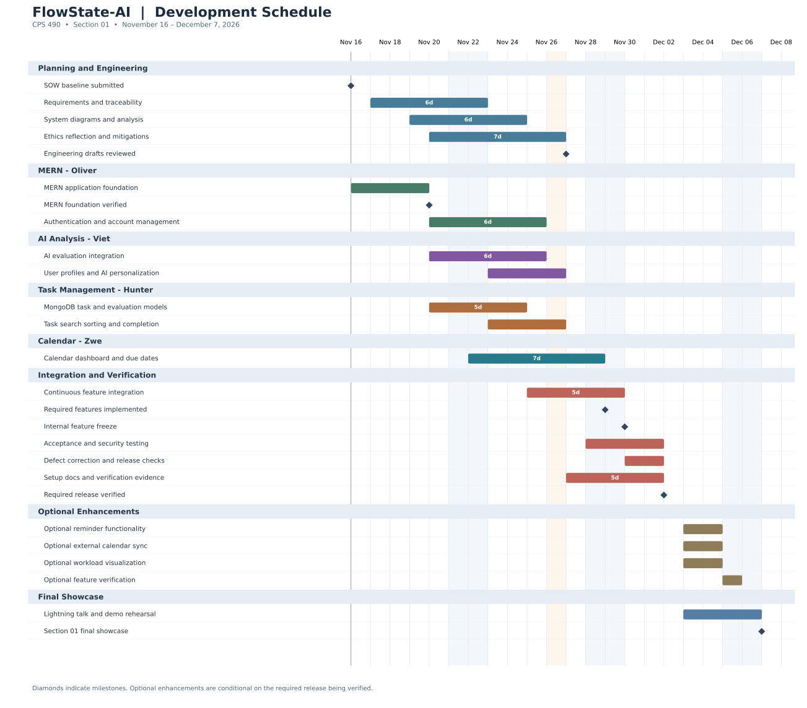

# FlowState-AI

**Course:** CPS 490 — Capstone I, Fall 2026, Section 01  
**Project Pathway:** Option 2 — Original MERN Project (TEAM 16)

| Team Member | GitHub Username |
| --- | --- |
| Oliver Joseph | `Oliver-T-Joseph` |
| Hunter Clay | `HClay28` |
| Zwe Htet | `markzwe` |
| Viet Quoc Dat Le | `QuocDat101` |

## 1. Project Purpose and Objectives - OJ
FlowState-AI is an AI-powered task management application designed to help users evaluate, organize, and prioritize creative tasks. Users submit one task at a time for AI analysis based on difficulty, estimated completion time, urgency, creative effort, and importance. The application provides an explanation of the evaluation and suggests actionable steps for completing the task. Users can also save and manage tasks, receive personalized recommendations based on their profiles, and track deadlines through a calendar.

### Continuity with TEAM 01

FlowState-AI builds on the single-task AI analyzer proposed in TEAM 01. The existing Node.js prototype provides AI task evaluation through an HTML/JavaScript interface and uses SQLite for storage. This capstone project extends that work into a MERN application by introducing a React frontend, an Express/Node.js API, MongoDB persistence, user accounts, profile-based AI personalization, task organization, and an in-app calendar. Reminders, external calendar synchronization, and color-coded workload analysis remain optional enhancements rather than minimum release requirements.

## 2. Stakeholders  - OJ

**Intended Users:** The user is the person who uses FlowState-AI to evaluate, organize, and manage creative tasks. Users are responsible for creating accounts, providing task descriptions and profile information, and managing their saved tasks and deadlines.

**Development Team:** The developers are the four team members responsible for building and maintaining FlowState-AI. They are responsible for implementing the application's features, integrating its components, testing functionality, reviewing each other's work, and preparing the required documentation.

**Reviewers:** The product owner is the four-member development team responsible for defining FlowState-AI's requirements, deciding which features are included in the project, and determining whether the completed application meets the agreed objectives.

## 3. Scope - ZH
### 3.1 Required Scope

The primary user is a registered FlowState user who wants to evaluate, prioritize, and schedule creative tasks.

* Provide an integrated MERN application using MongoDB, Express, React, and Node.js.
* Create an account, sign in, sign out, and delete the account.
* Submit one creative task at a time for AI analysis.
* Evaluate each task based on difficulty, estimated completion time, urgency, creative effort, and importance.
* Explain the evaluation in plain language and suggest three to six actionable steps, including a clear first step.
* Create and update user-profile information that provides context for personalized AI evaluations and recommendations.
* Save user-profile information, tasks, and AI evaluations in MongoDB so users can retrieve them in later sessions.
* Search saved tasks, filter them by urgency, and sort them by difficulty, estimated time, urgency, or due date.
* Assign due dates to saved tasks and view them on a calendar dashboard within FlowState.
* Mark tasks as complete and delete completed tasks.
* Restrict access to each user's profile, tasks, and evaluations to that user's account.

### 3.2 Out of Scope

* Analyzing multiple tasks in a single submission.
* Sharing tasks or collaborating across accounts.

### 3.3 Minimum Complete Release

The minimum complete release includes an integrated MERN application with account management, AI task analysis, profile-based AI personalization, persistent task management, and a calendar dashboard. A registered user can save profile information, receive personalized task evaluations, retrieve and organize saved tasks, assign due dates, view tasks on the calendar, and mark and delete completed tasks. Users can access only their own profiles, tasks, and evaluations.

### 3.4 Optional Enhancements

* Schedule and receive task reminders.
* Synchronize dated tasks with a supported external calendar service.
* Display color-coded workload indicators to distinguish dates with different task workloads.

The team will attempt these enhancements after the minimum required functionality has been implemented, integrated, and verified.

## 4. Deliverables - HC

The FlowState-AI team will deliver a functional MERN-based application alongside the engineering documentation, verification evidence, and demonstration materials required for the final project showcase. Each deliverable will have an observable result that can be reviewed and verified by the development team.

The deliverables will be maintained in the team's GitHub repositories, with the final application and supporting artifacts ready for the scheduled final showcase on December 7, 2026.

### 4.1 Required Deliverables

| ID | Deliverable | Reviewable Output and Evidence |
| --- | --- | --- |
| D1 | **Working MERN Foundation** | An integrated React/Vite frontend, Node.js/Express backend, and MongoDB/Mongoose database. Reviewers can start the application locally and verify communication between the frontend, backend, and database. Verified through AR4. |
| D2 | **User Account Management** | Functionality allowing users to register, sign in, sign out, and delete their accounts. Users can access only their own profiles, tasks, and evaluations. Verified through AC1 and AC7. |
| D3 | **AI Task Analysis and Personalization** | An interface allowing users to submit individual creative tasks for AI evaluation. Each evaluation provides difficulty, estimated completion time, urgency, creative effort, importance, a plain-language explanation, and three to six task-specific actions, including a suggested first step. Users can create, update, and save profile information that influences AI recommendations. Verified through AC2 and AC8. |
| D4 | **Task Storage and Management** | MongoDB-backed storage of tasks and their evaluations. Users can retrieve previous evaluations, search, filter, sort, mark tasks complete, and delete completed tasks. Verified through AC3–AC5 and persistence testing. |
| D5 | **Calendar Dashboard** | A visual calendar displaying users' saved tasks according to their assigned due dates. Users can view upcoming deadlines and identify tasks scheduled for specific dates. Verified through AC6. |
| D6 | **Requirements Engineering Documentation** | A requirements document containing functional and non-functional requirements with stable identifiers, measurable expectations, and traceability to important acceptance tests. Proposed location: `docs/requirements.md`. Verified through AR1. |
| D7 | **System Diagrams and Analysis** | At least one meaningful Data Flow Diagram (DFD) or Sequence Diagram, including editable diagram source, a readable rendered version, and an analysis explaining system responsibilities, dependencies, and relationships to requirements. Proposed locations: `docs/diagrams/` and `docs/analysis.md`. Verified through AR2. |
| D8 | **Engineering Ethics Reflection** | An evaluation of the application's cultural, economic, environmental, global, public health, public safety, public welfare, and social impacts. Significant risks will include proposed mitigations and connections to engineering decisions. Proposed location: `docs/ethics-reflection.md`. Verified through AR3. |
| D9 | **Verified Application and Release Package** | The integrated application source code, configuration examples, setup instructions, documented limitations, and reproducible acceptance-test results. Another team member can start the application from a clean repository checkout and verify its principal workflows. Proposed locations: `README.md` and `docs/verification.md`. Verified through AR4. |
| D10 | **Final Project Showcase** | A concise lightning talk and live demonstration of FlowState-AI during the Section 01 final examination period on December 7, 2026, from 10:10 a.m. to 12:00 noon. The demonstration will showcase the integrated application and provide evidence that the agreed functionality has been implemented and verified. Verified through AR5. |

### 4.2 Optional Deliverables

The following enhancements may be developed after the minimum required functionality has been implemented, integrated, and verified. These features are not required for the minimum complete project and will only be included in the final demonstration if successfully implemented and tested.

| ID | Optional Deliverable | Reviewable Output and Evidence |
| --- | --- | --- |
| OD1 | **Automated Task Reminders** | Users can schedule reminders for tasks and receive notifications at the specified time through an agreed notification method. Verified through OC1. |
| OD2 | **External Calendar Synchronization** | Users can synchronize dated FlowState-AI tasks with a supported external calendar service. Verification will confirm that task information appears correctly in the external calendar. Verified through OC2. |
| OD3 | **Color-Coded Workload Analysis** | The calendar visually distinguishes dates with different task workloads using color-coded indicators. Verification will compare dates containing different task quantities and confirm the appropriate visual indicators appear. Verified through OC3. |

Optional features will be prioritized based on remaining development time, technical feasibility, and team agreement. Incomplete optional features will not prevent acceptance of the minimum complete project.

### 4.3 Delivery and Review

The team will target November 30, 2026, for completion and integration of all required application features. December 2, 2026, will serve as the internal verification and release-readiness checkpoint.

All required deliverables will undergo team review before the final showcase. The completed application, supporting engineering documentation, and verification evidence will be available for inspection at the beginning of the December 7, 2026, final examination period.

## 5. Assumptions, Constraints, and Dependencies - ZH
### 5.1 Assumptions

* The existing Node.js prototype's task-analysis logic can be reused in the MERN application.
* The AI service will be available during development, verification, and the final demonstration.
* Users will access FlowState through a web browser and supply task descriptions, due dates, and profile information for personalized recommendations.

### 5.2 Constraints

* The application will use the MERN stack (MongoDB, Express, React, and Node.js).
* The AI analysis engine will process one creative task per submission.
* Users will be able to access only the profiles, tasks, and evaluations associated with their own accounts.
* The project will be developed by a four-person team.
* The application and required engineering artifacts must be ready for inspection and a live demonstration by December 7, 2026, at 10:10 a.m.
* Optional enhancements will be attempted only after the minimum required functionality has been integrated and verified.

### 5.3 Dependencies

* Access to the existing FlowState source code and setup instructions.
* Access to an AI service that can generate task evaluations and actionable steps using the submitted task and saved profile information.
* A MongoDB instance for storing user accounts, profiles, tasks, due dates, and AI evaluations.
* Stored user-profile information available to the AI analysis workflow for personalization.
* A React calendar component, such as FullCalendar, and a FlowState API that supplies the signed-in user's saved tasks and due dates.
* Agreed API endpoints and data formats between the authentication, AI analysis, task management, and calendar components.
* If reminders are implemented, an agreed notification method and a test environment for verifying scheduled delivery.
* If external calendar synchronization is implemented, access to the selected calendar service's API, required authorization, and a test account.
* If color-coded workload analysis is implemented, an agreed rule for calculating daily workload and mapping it to calendar colors.

## 6. Milestones and Schedule - HC

The FlowState-AI development schedule is designed to complete the minimum required application features by November 30, 2026. December 1–2 will be reserved for final integration verification, defect correction, and release preparation. Optional enhancements will only be pursued if the required functionality has been integrated and verified.

The team will develop the application through four primary workstreams, allowing members to work in parallel while coordinating shared interfaces and dependencies. Engineering documentation, testing, integration, and showcase preparation will be shared responsibilities throughout the project.

The official final delivery and showcase will take place on December 7, 2026, at 10:10 a.m., during the Section 01 final examination period.

### 6.1 Development Responsibilities

Each team member will serve as the primary developer for one major application component.

| Team Member | Primary Responsibility | Development Tasks |
| --- | --- | --- |
| Oliver Joseph | MERN Foundation & Authentication | Establish the MERN application architecture, configure frontend/backend communication, connect MongoDB, and implement user registration, login, logout, account deletion, and authentication/authorization. |
| Viet Quoc Dat Le | AI Analysis & Evaluation | Integrate the existing AI analyzer, implement task submission and evaluation, generate actionable steps, and implement user-profile-based AI personalization, including profile creation and updates. |
| Hunter Clay | Task Management & Database | Develop MongoDB task and evaluation models, implement persistent storage and retrieval, search, filtering, sorting, task completion, and deletion. Coordinate with Viet on profile data storage and with Zwe on task due-date data. |
| Zwe Htet | Calendar & Scheduling | Develop the calendar dashboard, display saved tasks by due date, and integrate the calendar with task data. Implement optional reminders, external calendar synchronization, and color-coded workload analysis if time permits. |

All team members will be responsible for testing their assigned components, participating in code reviews, and assisting with integration. Each major feature will be reviewed by at least one additional team member before being accepted into the integrated application.

Requirements documentation, system diagrams and analysis, the ethics reflection, verification evidence, and final showcase preparation will be distributed among the team, with responsibility for each artifact tracked as part of the project plan.

Development work will be coordinated through GitHub, with changes reviewed and integrated throughout the project rather than waiting until final delivery.

### 6.2 Schedule (Gantt Chart)

The following Gantt chart outlines the major development activities, engineering documentation, integration, verification, and final showcase preparation.

Required features will be prioritized over optional enhancements. The schedule includes time for parallel development, integration, and verification before the final presentation.

**Gantt chart files:** [Rendered SVG](./gantt.svg) · [PNG copy](./gantt.png)

**Key Dependencies:** The MERN foundation must be operational before full-stack features can be reliably integrated. Authentication and persistent task storage support account-specific task management. AI personalization depends on stored user-profile information, while calendar functionality depends on saved tasks and due dates.

The team will establish shared API contracts so that development can proceed in parallel. Final acceptance testing will verify the required workflows described in AC1–AC8 and confirm that the components function together as one application.

Optional enhancement activities shown in the Gantt chart represent potential development windows rather than guaranteed delivery commitments. Only optional features that can be implemented and verified without compromising the minimum complete release will be included in the final demonstration.

### 6.3 Milestones

| ID | Target Date | Milestone | Evidence at Checkpoint |
| --- | --- | --- | --- |
| M0 | Nov. 16 | SOW Baseline Submitted | Team SOW, project scope, development assignments, and initial schedule are finalized and submitted. |
| M1 | Nov. 20 | MERN Foundation Ready | React frontend, Express backend, and MongoDB communicate successfully. |
| M2 | Nov. 27 | Engineering Documentation Drafts Reviewed | Requirements, diagrams and analysis, and ethics reflection drafts are available for team review. |
| M3 | Nov. 29 | Required Features Implemented | Authentication, AI evaluation, personalization, task management, and the calendar dashboard are available for integrated review. |
| M4 | Nov. 30 | Required Feature Integration Complete | All minimum required functionality is integrated into a feature-complete application. |
| M5 | Dec. 2 | Required Release Verified | AC1–AC8 and relevant security checks have been executed, results recorded, blocking defects addressed, and setup documentation made available. |
| M6 | Dec. 7, 10:10 a.m. | Final Project Showcase | Team delivers the lightning talk and live application demonstration, with completed engineering artifacts available for inspection. |

### 6.4 Risks and Scope Changes

The development schedule assumes that the existing FlowState-AI task-analysis logic can be reused within the MERN application and that team members can work on their assigned components in parallel. Because the project involves integrating an existing AI analyzer with new authentication, database, and calendar functionality, several risks could affect delivery.

The team will monitor these risks throughout development and address issues as they arise to protect the minimum complete release and December 7 showcase.

| Risk | Effect on Delivery | Mitigation or Fallback |
| --- | --- | --- |
| Integrating the existing AI analyzer into the MERN application takes longer than expected. | AI analysis and personalization may delay integration and testing. | Test the analyzer through the Express API early. Reuse working analysis logic and prioritize the required evaluation fields and personalized action steps. |
| Team components use inconsistent API endpoints or data formats. | Features may work individually but fail when combined. | Agree on shared API contracts early, review changes, and integrate working components regularly. |
| The AI service becomes unavailable or reaches its usage limit. | Task analysis and personalization cannot be completed or demonstrated. | Check access and usage limits early, handle failed requests clearly, and evaluate an alternative compatible service if necessary. Saved evaluations can demonstrate retrieval during an outage, while live AI acceptance remains pending. |
| Reduced team availability during Thanksgiving week. | Implementation and review tasks may fall behind schedule. | Confirm availability in advance, report progress regularly, and reassign blocked tasks when another member has capacity. |
| Optional enhancements take time needed for required features. | Integration, verification, or showcase preparation may be delayed. | Prioritize the minimum complete release and defer optional features that cannot be implemented and tested within the remaining time. |

#### Optional Feature Decisions

At the December 2 verification checkpoint, the team will review the required acceptance-test results, unresolved defects, and remaining development time before deciding which optional enhancements to attempt.

Reminders, external calendar synchronization, and color-coded workload analysis may be deferred if implementing them would interfere with required functionality, testing, or final demonstration preparation.

These enhancements are not required for acceptance of the minimum complete release. Any optional feature included in the final application must be successfully integrated and verified before being presented as completed functionality.

#### Scope Change Management

The team will record scope-related decisions, their justifications, and their effects on the development plan in the project repository.

Required features remain delivery commitments. If a required feature is at risk, the team will document the issue, evaluate corrective actions, and seek instructor agreement before reducing the approved project scope.

Approved changes will be reflected consistently in the Statement of Work, deliverables, Gantt chart, requirements documentation, and acceptance criteria.

Deferred optional features and any unresolved required work will be clearly identified in the final documentation.

This process will allow the team to respond to development challenges while maintaining a clear distinction between required functionality and optional enhancements. The November 30 feature-freeze target and December 2 verification checkpoint are intended to preserve time for final corrections, showcase preparation, and demonstration rehearsal before December 7.

## 7. Acceptance

### 7.1 Minimum product criteria

A and B are distinct test accounts. Use a disposable account for AC1. The minimum product passes when a reviewer can reproduce AC1–AC8.

| ID | Starting condition and action | Required observable result |
|---|---|---|
| AC1 | **Account management.** Register a new account, sign in, delete the account, and try to sign in again with the same credentials. | Sign-in succeeds after registration. After deletion, the same credentials are rejected. |
| AC2 | **Task analysis.** A submits one creative task, such as “Design a poster for Friday’s concert,” along with a task description. | The response gives the task’s difficulty, estimated time, urgency, creative effort, and importance. It explains the evaluation in plain language and lists three to six actions specific to the task, with a clear first step. |
| AC3 | **Task and response storage.** A submits two distinct tasks and records each response. Restart the app, sign in again, and retrieve both tasks. Inspect the corresponding MongoDB records. | Each task opens with its original evaluation, explanation, and action steps. MongoDB contains both tasks and the response associated with each. |
| AC4 | **Search, filter, and sort.** Start with three saved tasks that match the same search term. Two share an urgency level and have different estimated times. A searches for the term, filters to that urgency, and sorts by estimated time from shortest to longest. | The initial search includes all three tasks. The filtered results contain only the two with the selected urgency, with the shorter task first. |
| AC5 | **Completion and deletion.** A starts with two unfinished tasks, marks one complete, and reloads the list. A then deletes the completed task and searches for each task by name. | After reload, only the selected task is marked complete. After deletion, that task disappears from the list and search results. The other task remains available and unfinished. |
| AC6 | **Calendar dashboard.** A assigns two tasks with different due dates, reloads the dashboard, and locates both tasks on the calendar. | The calendar displays each task by name on its assigned date. |
| AC7 | **Authorization.** A saves a task. B signs in and attempts to retrieve and delete A’s task using its identifier. A signed-out user also attempts to retrieve it. | Neither user receives A’s task data. The deletion is denied, and A can still open the task and its original evaluation. |
| AC8 | **Profile and personalization.** A sets their job to “ceramics instructor,” reloads the profile, and submits “Plan a creative activity for my next class” along with the description without mentioning ceramics in the task. | The profile still shows “ceramics instructor.” The explanation, or at least one action using that context, for example, by suggesting a clay exercise for the class. |

### 7.2 Final deliverable review

| ID | Deliverable and review action | Required observable result |
|---|---|---|
| AR1 | **Requirements and verification.** Review the functional and quality requirements. Follow the verification reference for each major requirement. | Requirements have distinct IDs. Each major requirement points to a test or review check with an expected result and recorded evidence. |
| AR2 | **Diagram and analysis.** Open the editable source and rendered version of a data flow or sequence diagram. Trace a workflow such as submitting a task and retrieving its evaluation. | The source and rendering describe the same workflow. The analysis explains what the diagram reveals and connects it to identified requirements. |
| AR3 | **Ethics reflection.** Review the discussion of cultural, economic, environmental, global, public health, public safety, public welfare, and social impacts. | The reflection addresses each area, explains low-impact findings, and connects significant impacts to a practical mitigation and an engineering choice. |
| AR4 | **MERN implementation and reproducibility.** Starting from a clean checkout, follow the documented configuration and setup steps. Submit a task in React, trace its request through Express on Node.js, and inspect the saved task and evaluation in MongoDB. | The documented steps start the application. The React interface displays the evaluation returned by the API, and the MongoDB record matches the submitted task and displayed response. The repository includes repeatable verification steps and recorded results for AC1–AC8. |
| AR5 | **Final showcase.** During the scheduled final period, give a lightning talk and demonstrate one task from submission through completion. | The audience sees the task evaluation and suggested steps, the saved task retrieved through search, its due date on the calendar, and its completed status after reload. |

### 7.3 Optional feature criteria

| ID | Starting condition and action | Required observable result |
|---|---|---|
| OC1 | **Reminders.** A schedules a reminder for a task and waits until the reminder is due. | A receives a reminder identifying the correct task at its scheduled time. |
| OC2 | **External calendar sync.** Using the agreed calendar provider and sync direction, create a dated task or event in the source calendar and run the sync. | The destination calendar displays the corresponding entry with the same title and due date. |
| OC3 | **Color-coded workload.** Start with two empty dates. Schedule three comparable tasks on one date and one on the other, each with the same estimated time, difficulty, urgency, creative effort, and importance. Open the dashboard. | The dates have different workload colors, and the calendar identifies the date with three tasks as the busier day. |
